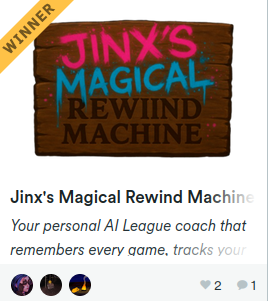

<div align="center">
  
</div>

# RiftRewind

**Prize winner, AWS x Riot Games Hackathon 2025:** "Roast Master 3000" prize, 1000 USD.
[Devpost page](https://devpost.com/software/jinx-s-workshop) · [Documentation](https://m3rick.github.io/Jinx-s_Magical_Rewind_Machine/)

A League of Legends coaching site. It pulls a player's recent matches from the Riot API, shows how they played on a clickable map of Summoner's Rift, and lets them chat with an AI coach (Claude Sonnet 4.5 on AWS Bedrock) that remembers past sessions. Every piece of feedback comes in two tones: a serious coach, or a roast.

## Team

| Member | Role |
|--------|------|
| Aymeric L. | Riot API integration (Pulsefire), match data processing, interactive map, frontend, coaching interface |
| Thierry B. | Flask backend, AWS infrastructure (Elastic Beanstalk, DynamoDB, Bedrock), AI integration, database |
| Hugo P. | Player card generation (Pillow), Docker setup |

## What it does

- **Interactive map.** Click a lane, the jungle, dragon or baron to get feedback on that zone, built from your recent matches.
- **AI coach with memory.** The coach can query your match history and League data through tool calls (LangChain), and your conversations are stored per player in DynamoDB, so it picks up where you left off.
- **Player cards.** A shareable image with a title and description written from your playstyle, over your most-played champion.

## How it works

| Layer | Stack |
|-------|-------|
| Backend | Python 3.12, Flask |
| Match data | Riot Games API through Pulsefire, aggregated with Pandas |
| AI | Claude Sonnet 4.5 on AWS Bedrock, LangChain tool calling |
| Storage | SQLite for static game data (champions, items, runes), DynamoDB for players and conversations |
| Frontend | Plain HTML, CSS and JavaScript, Canvas for the map |
| Cards | Pillow with the Teko font |
| Deployment | Docker, AWS Elastic Beanstalk (the hackathon deployment is now offline) |

## Run it locally

```bash
git clone https://github.com/M3RICK/Jinx-s_Magical_Rewind_Machine.git
cd Jinx-s_Magical_Rewind_Machine
```

Create a `.env` file next to `docker-compose.yml`:

```bash
RIOT_API_KEY=your_riot_key
AWS_REGION=eu-west-3
AWS_ACCESS_KEY_ID=your_key
AWS_SECRET_ACCESS_KEY=your_secret
```

Then start it and open http://localhost:

```bash
docker compose up --build
```

No AWS account? Set `USE_MOCK_DB=true` and `USE_MOCK_AI=true` in `docker-compose.yml` to run with a mock database and a mock coach.

## Credits

Built for the [Rift Rewind hackathon](https://riftrewind.devpost.com/) organized by Riot Games and Amazon Web Services. Claude Sonnet 4.5 by Anthropic, through AWS Bedrock. Riot API access through [Pulsefire](https://github.com/ianhco/pulsefire).

## License

MIT, see [LICENSE](LICENSE).
